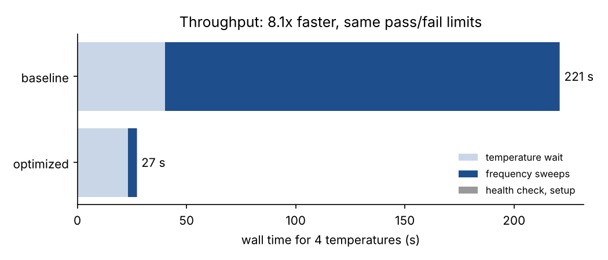
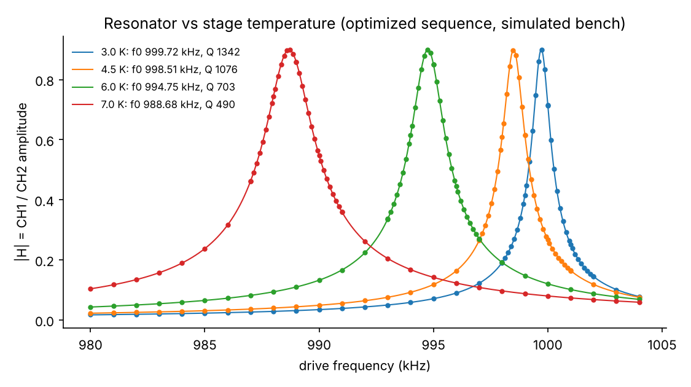
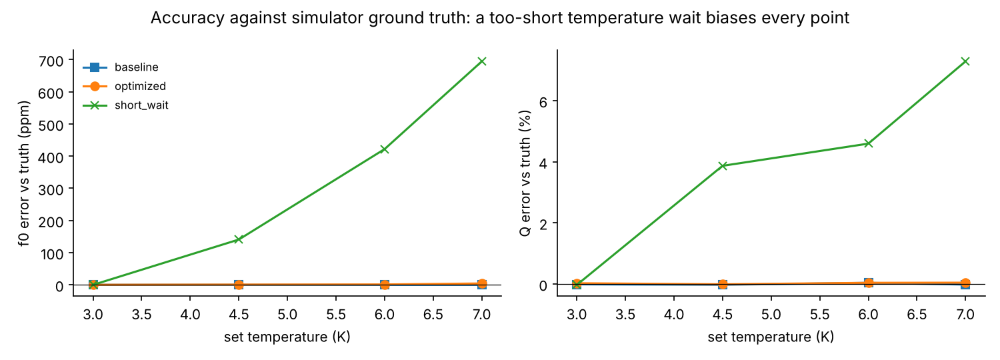

# Automated measurement sequences for a cryogenic resonator test bench

Python (PyVISA / SCPI) code that builds, runs and debugs automated measurement
sequences on a three-instrument bench: a **function generator**, a two-channel
**oscilloscope**, and a **cryogenic temperature controller**. It characterizes a
temperature-dependent resonator (centre frequency and quality factor versus
stage temperature, with superconducting-style temperature dependence).

> **The instruments are simulated.** `amseq/simulator.py` implements SCPI servers
> over TCP sockets that behave like LAN instruments: per-command latency, finite
> link bandwidth, 8-bit quantization, noise, a drifting scope offset, resonator
> ring-down, thermal lag, and optional dropped replies. The drivers use standard
> VISA resource strings (`TCPIP0::host::port::SOCKET`) and nothing
> simulator-specific, but this code has **not** been run on physical instruments.
> The simulator knows the true f0 and Q, which is what makes accuracy measurable.

## Results

Four temperatures (3.0, 4.5, 6.0, 7.0 K), same pass/fail limits for every run
(`results/benchmark.json`). The simulator's physics runs on wall-clock time, so
small numbers move between runs: on a rerun the optimized f0 error was 4.7 ppm
and the speed-ups were 8.1x and 47x.

| Run | Wall time | Sweep time | Points / sweep | Data in | max \|f0 error\| | max \|Q error\| |
|---|---|---|---|---|---|---|
| **baseline** (typical first script) | 221.0 s | 180.6 s | 201 | 43.4 MB | 0.3 ppm | 0.04% |
| **optimized** | **27.3 s** | **3.9 s** | 56 | 0.47 MB | 4.3 ppm | 0.04% |
| short_wait (failure case) | 11.9 s | 3.8 s | 56 | 0.46 MB | **694.6 ppm** | **7.3%** |
| faults (3% of replies dropped) | 30.0 s | 7.1 s | 56 | 0.47 MB | 4.8 ppm | 0.5% |

* **Throughput: 8.1x faster overall, 46.7x faster sweeps** at the same limits.
  Where it came from:
  * settle time sized to the resonator ring-down (Q / pi f0, about 0.5 ms) instead of a fixed 20 ms;
  * no `*OPC?` after each frequency step;
  * IEEE 488.2 binary block transfers instead of ASCII (92x less data);
  * source, format and preamble cached instead of re-sent before each capture;
  * reference channel measured once per sweep instead of every point;
  * an adaptive grid (coarse pass, then a fine pass around the peak) instead of 201 uniform points.

  Temperature waits went from a fixed 10 s to a stability criterion (every reading in a
  1 s window within 5 mK), 1.7x faster.
* **Accuracy cost of the speed-up is small:** f0 within 4.3 ppm and Q within 0.04%
  of truth, against 0.3 ppm and 0.04% for the slow baseline.
* **The limit checks did not catch the real failure.** With a fixed 2 s wait,
  shorter than the stage needs, every point *passed* the Q and fit-uncertainty
  limits while f0 was off by up to 695 ppm and Q by 7.3%: the stage had not
  reached temperature. A stability-based wait fixes it. Pass/fail limits on
  fit quality cannot detect a wrong operating point.
* **Fault tolerance:** with 3% of replies dropped, the drivers hit 19 timeouts,
  retried each one, and the sequence finished with the same accuracy.
* **Instrument health check** before every run: `*TST?` self-tests, error
  queues, scope offset on a grounded input (3.97 mV found, re-zeroed to
  -0.01 mV), digitizer ENOB by the IEEE 1057 four-parameter sine fit
  (6.71 bits on the 8-bit channel), sensor sanity. Each check is appended to
  `health_log.jsonl`, giving a maintenance history.





## How it works

```
sequences/*.yaml        what to run: steps, parameters, limits
amseq/sequencer.py      step engine: retries per step, JSONL run log, CSV/JSON results
amseq/drivers.py        PyVISA drivers: timeouts, retries, error queue, I/O trace
amseq/analysis.py       IEEE 1057 three- and four-parameter sine fits, ENOB, resonance fit
amseq/simulator.py      SCPI instrument simulators and the physical model
run_all.py, report.py   benchmark and figures
docs/test_procedure.md  written test procedure: setup, steps, limits, records
tests/                  pytest suite against the simulators
```

A sequence is data, not code:

```yaml
steps:
  - {type: health_check}
  - {type: configure}
  - type: for_each_temperature
    steps:
      - {type: set_temperature, wait: stable, tol_K: 0.005, window_s: 1.0, timeout_s: 30}
      - {type: sweep, mode: adaptive, coarse_points: 25, fine_points: 31, settle_ms: 2.0,
         binary: true, cache: true, reference: once}
      - {type: fit_resonance}
      - {type: check_limits, Q_min: 300, f0_se_max_Hz: 20}
```

Amplitudes at each frequency come from the IEEE 1057 three-parameter sine fit
at the known drive frequency, on both channels; |H| = CH1 / CH2. The resonance
is a least-squares fit of a single-pole Lorentzian magnitude.

**Debugging aids.** Every SCPI command is timed and recorded (`IOStats.trace`;
set the `amseq.io` logger to DEBUG to print it). Each step's outcome, retries
and errors go to `run_log.jsonl`. Results are written even if a run aborts.

## Run it

```bash
pip install -r requirements.txt
python run_all.py      # all four runs and figures, about 5 minutes
pytest -q              # 9 tests, about 20 seconds
```

## What I would change for real hardware

* Replace the resource strings with the instruments' addresses and map any
  command-set differences in `drivers.py`. Real scopes also need trigger setup
  and vertical auto-ranging, which the simulator does not require.
* Use the instrument's own operation-complete and status-byte handling where
  available, instead of the fixed settle time.
* Add a calibration record (instrument serials, last calibration date) to the
  run metadata.

Author: Zaif Mohammed
